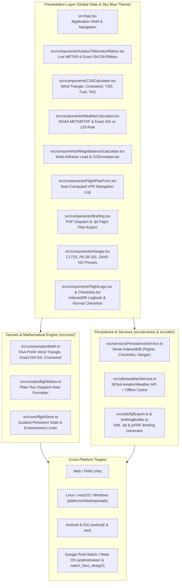

# AviationPro — Pre-Flight Dispatch & E6B Desk Companion

[](LICENSE)
[](tsconfig.json)
[](vite.config.ts)
[](package.json)

**AviationPro** is an offline-first pre-flight dispatch and E6B/CX-6 flight computer built for student pilots, CFIs, and general aviation flight desks. Designed to sit alongside **Flight Schedule Pro**, **PilotBase**, **ForeFlight**, and **E6BX**, it provides exact ISA performance calculations, wind-triangle navigation, multi-airframe Weight & Balance CG envelope visualization, and one-click plain-text preflight dispatch notes.

> **Important Pre-Flight Notice:** AviationPro is a supplemental pre-flight planning and training aid. It is not an FAA-certified flight deck system. Pilots in Command must always verify performance, weight & balance, and weather data against the official aircraft Pilot's Operating Handbook (POH) and official aviation weather briefings prior to flight.

---

## Enterprise Architecture & Directory Structure



### Repository Layout

```text
AviationPro/
├── src/
│   ├── core/                        # Pure TypeScript domain math, store & unit tests
│   │   ├── aviationMath.ts          # Exact ISA DA, wind triangle (sin/cos/asin), crosswind
│   │   ├── aviationMath.test.ts     # Comprehensive unit tests for edge & wrap cases
│   │   ├── flightStore.ts           # Zustand persistent flight & airframe store
│   │   ├── preflightNotes.ts        # Plain-text dispatch note builder for FSP / PilotBase
│   │   └── preflightNotes.test.ts   # Dispatch note verification suite
│   ├── components/                  # React UI modules (Global Slate & Sky Blue Desk Theme)
│   │   ├── AviationTelemetryRibbon.tsx
│   │   ├── Briefing.tsx
│   │   ├── CGEnvelope.tsx
│   │   ├── Checklists.tsx
│   │   ├── CX6Calculator.tsx
│   │   ├── FlightLogs.tsx
│   │   ├── FlightPlanForm.tsx
│   │   ├── Hangar.tsx
│   │   ├── PlannerHub.tsx
│   │   ├── WeatherCalculator.tsx
│   │   └── WeightBalanceCalculator.tsx
│   ├── services/
│   │   └── PersistenceService.ts    # Dexie.js IndexedDB offline database
│   ├── utils/
│   │   ├── briefingBuilder.ts       # jsPDF flight briefing generator
│   │   ├── fplExport.ts             # Waypoint XML (.fpl), CSV, and JSON exporters
│   │   ├── platform.ts              # Runtime target detection (Wails, Capacitor, Web)
│   │   └── weatherService.ts        # NOAA METAR/TAF parser with 30-min offline cache
│   ├── data/
│   │   └── sampleAircrafts.json     # C172S Skyhawk, PA-28-181 Archer, DA40 NG presets
│   ├── hooks/
│   │   └── useAviation.ts           # Reactive Dexie query hook
│   ├── types/
│   │   └── aviation.ts              # Strict TypeScript interfaces
│   ├── App.tsx                      # Root application layout
│   ├── index.css                    # Global Slate & Sky Blue CSS custom properties
│   └── main.tsx                     # Application bootstrap
├── scripts/                         # Local verification & multi-platform build scripts
│   ├── verify-all.sh                # Runs tsc, terminology check, bun test, and build
│   ├── build-web.sh                 # Builds production web bundle
│   ├── build-desktop.sh             # Builds native Wails desktop binary
│   └── build-mobile.sh              # Syncs Capacitor Android/iOS & Wear OS targets
├── platforms/
│   ├── desktop/wails/               # Go + Wails native desktop wrapper
│   └── mobile/capacitor/            # Capacitor mobile configuration
├── android/                         # Android & Wear OS companion app (android/wear/)
├── ios/                             # iOS Capacitor target
├── watch_face_design/               # Google Pixel Watch 1 Watch Face Studio project & AAB
└── WATCH_FACE_SPEC.md               # Wear OS watch face specification
```

---

## Core Capabilities

1. **Exact ISA Density Altitude & 120 Rule Cross-Check (`src/core/aviationMath.ts`)**
   - Computes Pressure Altitude $\text{PA} = \text{Elev} + (29.92 - \text{Altimeter}) \times 1000$, standard temperature $T_{\text{ISA}} = 15 - 0.0019812 \times \text{PA}$, and exact ISA Density Altitude via the international barometric exponent ($0.234969$), alongside the $120\text{ ft}/^\circ\text{C}$ rule-of-thumb cross-check.
2. **FAA Wind Triangle & Runway Crosswind Solver**
   - Full law-of-sines Wind Correction Angle ($\text{WCA}$), True Heading ($\text{TH}$), and Ground Speed ($\text{GS}$) solver with explicit `WIND EXCEEDS TAS` and `INVALID INPUT` status handling.
   - Runway Crosswind resolver supporting both runway designators (`01`–`36`) and 3-digit magnetic headings (`001`–`360`), gust-aware crosswind/tailwind evaluation, and explicit pilot/CFI endorsement limits.
3. **One-Click Dispatch Notes (`src/core/preflightNotes.ts`)**
   - Generates a 5-line plain-text summary block (`AviationPro Preflight`, `ACFT`, `WX`, `RWY`, `NAV`) ready to paste directly into **Flight Schedule Pro**, **PilotBase**, or **ForeFlight** flight notes.
4. **Dynamic Multi-Airframe Weight & Balance (`src/components/WeightBalanceCalculator.tsx`)**
   - Interactive SVG Center of Gravity envelope (`CGEnvelope.tsx`) dynamically scaled to the active airframe's POH forward/aft CG limits and max gross weight (Cessna 172S, Piper Archer II, Diamond DA40 NG, or custom Hangar profiles).
5. **Google Pixel Watch 1 / Wear OS Companion (`watch_face_design/` & `android/wear/`)**
   - Dedicated wrist telemetry watch face (`AVPR0.wfs` / `com.aviationpro.wear.face.aab`) and Wear OS companion module.

---

## Local Build & Verification Pipeline

All verification and builds run locally via `scripts/` with zero cloud CI dependencies:

```bash
# Run full verification suite (TypeScript, terminology audit, unit tests, production bundle)
./scripts/verify-all.sh

# Run unit tests directly
bun test

# Start local development server
bun run dev

# Build production web bundle
./scripts/build-web.sh

# Build native desktop binary (requires Go + Wails CLI)
./scripts/build-desktop.sh

# Sync mobile & Wear OS targets
./scripts/build-mobile.sh
```
