# ✈️ AviationPro

**Live demo:** [https://robfernan.github.io/AviationPro/](https://robfernan.github.io/AviationPro/)

Also on the portfolio: [https://robertfernandez.dev/aviation](https://robertfernandez.dev/aviation)

### Multi-tab EFB and pilot utilities

NavLog, flight calculators, weather, and weight & balance in one offline-first app. The same tabbed layout runs in the browser, a Wails desktop shell, and a Capacitor Android build. Built by an FAA student pilot (129.2+ hours, as shown in the live app). A training and preflight reference — verify every number against the POH and the Pilot in Command.

If the demo is useful on a desk or a kneeboard, star the repo.

[](https://robfernan.github.io/AviationPro/)
[](https://bun.sh)
[](https://react.dev/)
[-00ADD8?style=for-the-badge&logo=go)](https://wails.io/)
[](https://capacitorjs.com/)
[](./LICENSE)

---

## Screenshots

| **Desktop** | **Mobile** | **Wear OS** | **Watch face** |
| :--- | :--- | :--- | :--- |
| 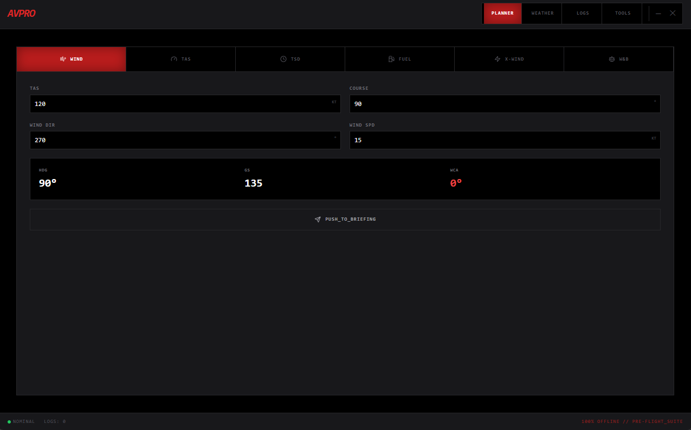 | 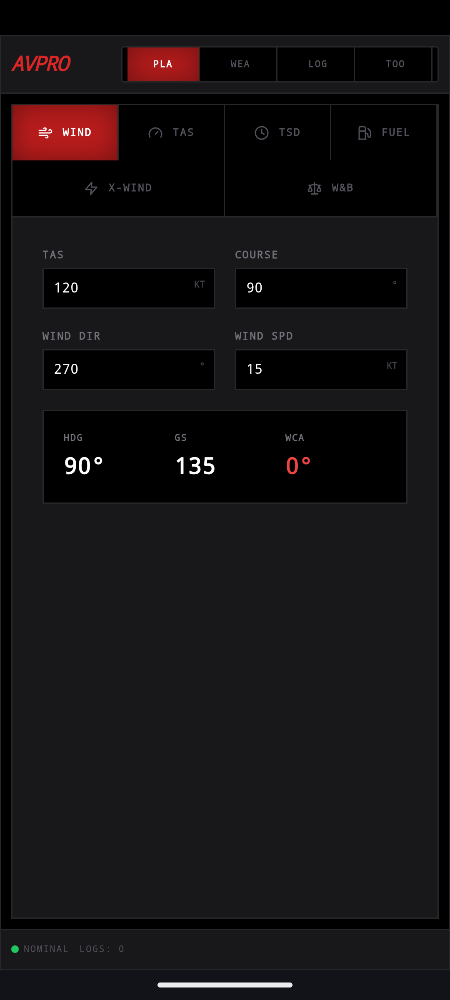 | 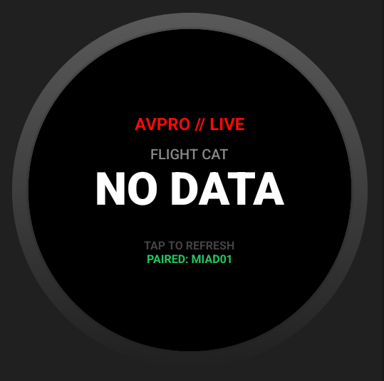 | 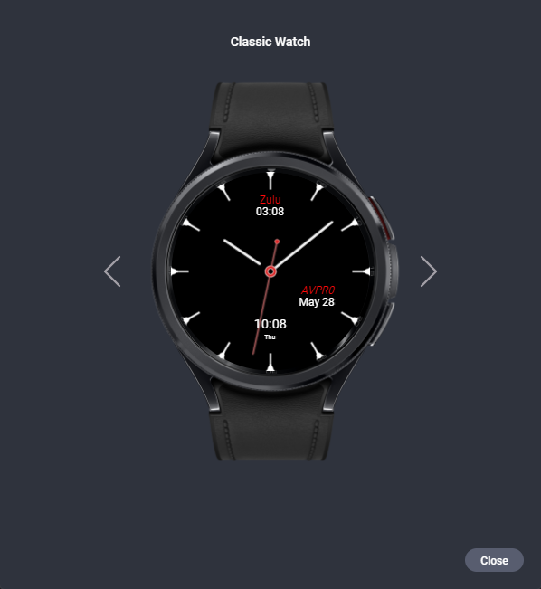 |
| *Wind triangle on the desktop shell.* | *Same tabs on a phone-width layout.* | *Flight-category screen (no data in this capture).* | *Zulu time, local time, and date.* |

| **Weight & balance** | **Weather** | **Briefing** | **Flight log** |
| :--- | :--- | :--- | :--- |
| 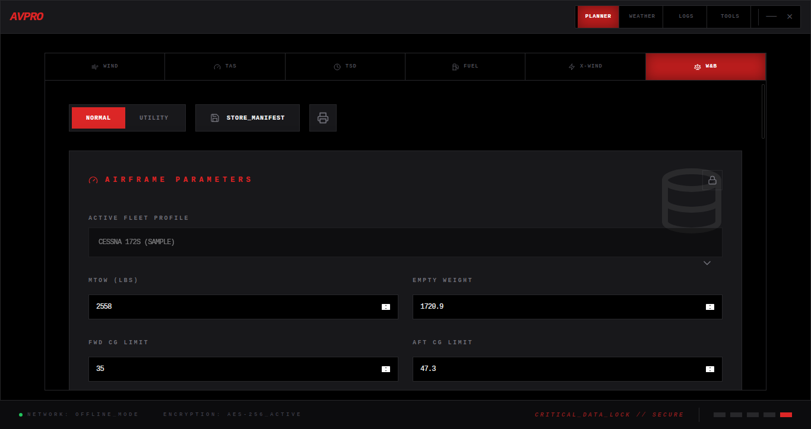 | 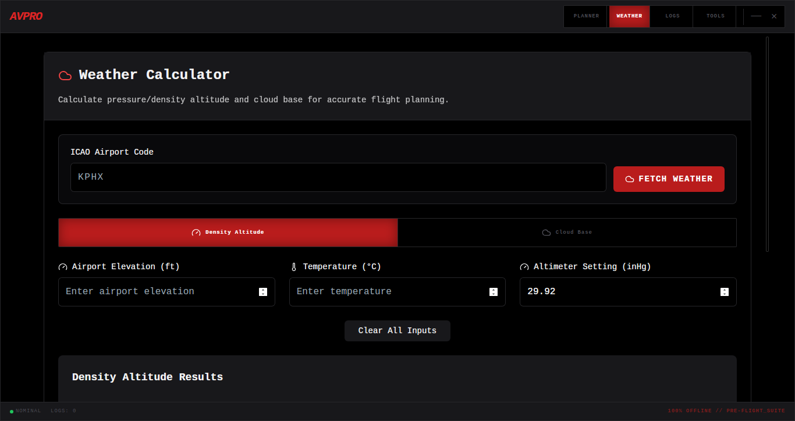 | 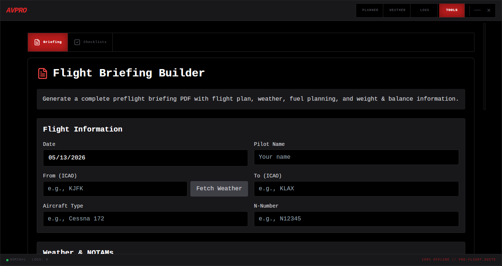 | 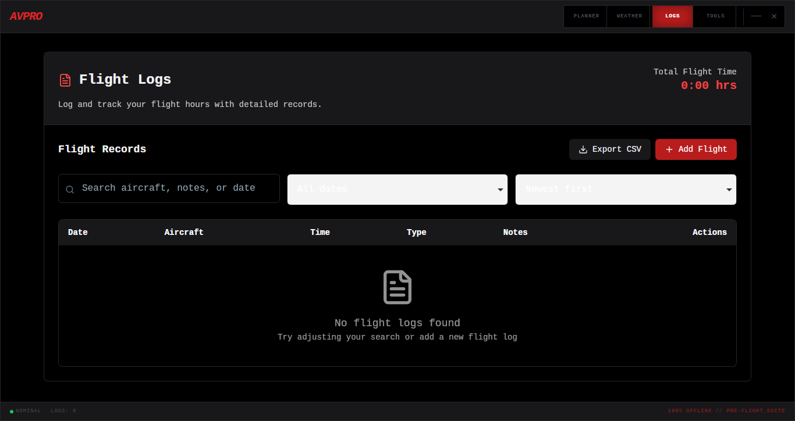 |
| *Sample Cessna 172S loading form.* | *Weather calculator tab.* | *Preflight briefing builder.* | *Flight log tab.* |

| **Wind** | **TAS** | **Time–speed–distance** | **Fuel** | **Crosswind** |
| :--- | :--- | :--- | :--- | :--- |
| 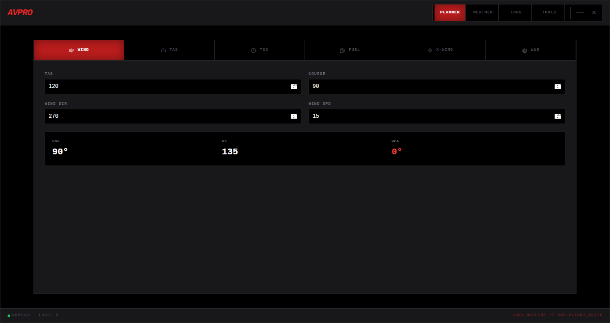 | 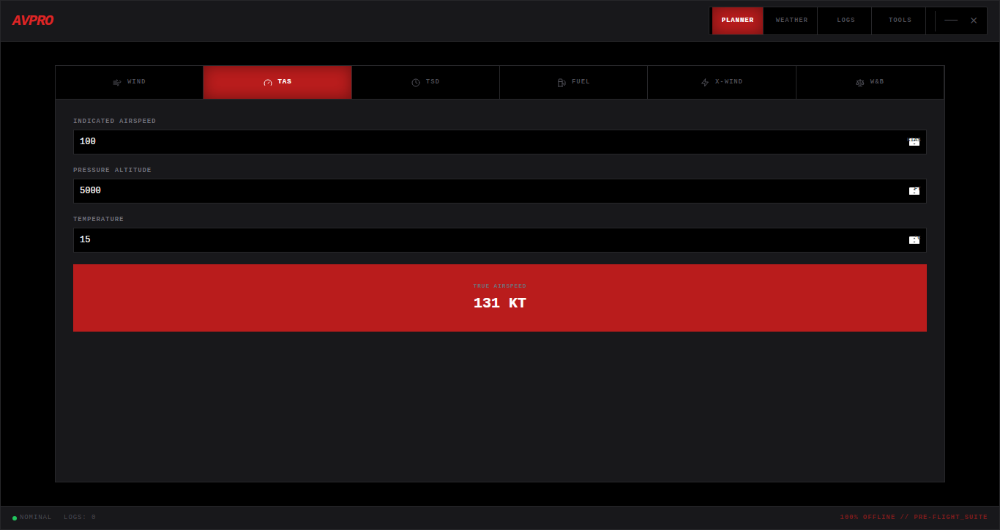 | 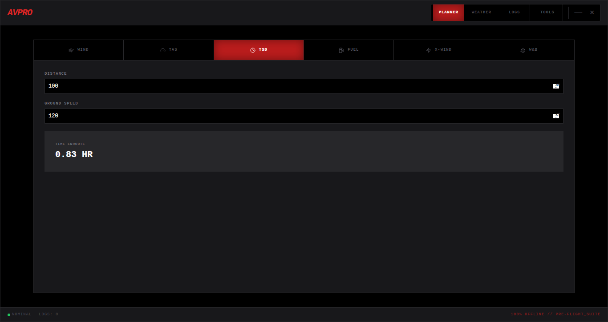 | 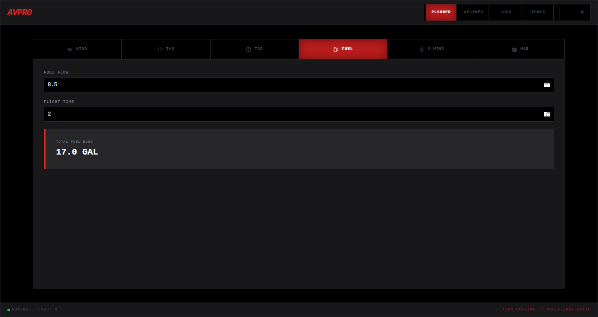 | 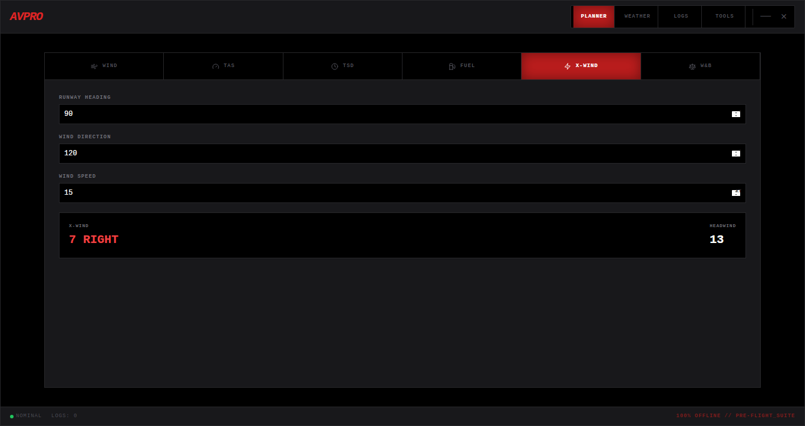 |

---

## What it covers

Planning math and saved logs run locally. Live METAR decode needs a network connection to `aviationweather.gov`. Garmin / ForeFlight `.fpl` export is included from the briefing flow.

### 1. 📡 Weather ribbon
* **METAR decode** from `aviationweather.gov`, including training fields such as `KF45`, `KDJT`, `KIMM`, `KOBE`, `KMIA`, and `KFXE`.
* **Flight category colors:** VFR, MVFR, IFR, and LIFR.
* **Station strip:** Zulu and local time, wind, temperature, altimeter, and the raw METAR, with one-click station changes.

### 2. 🧮 Flight computer
* **Wind triangle:** true heading, groundspeed, and wind correction angle.
* **True airspeed** from indicated airspeed, pressure altitude, and outside air temperature.
* **Time–speed–distance** for leg time and remaining distance.
* **Fuel:** gallons per hour, endurance, and 100LL weight.
* **Crosswind and headwind** components, with a crosswind-limit warning.

### 3. ⚖️ Weight & balance
* **C172 envelope** for normal category (up to 2,550 lb) and utility category (up to 2,200 lb).
* **CG through the flight:** ramp, takeoff, and landing as fuel burns.
* **Out-of-limits alert** when weight or moment leaves the envelope used by the profile.

### 4. 🗺️ NavLog and briefing
* **Navigation log** with course, altitude, wind, TAS, headings, distance, groundspeed, time, and VOR fields.
* **`.fpl` export** in the Garmin / ForeFlight XML shape for import into those apps or compatible avionics.
* **Printable briefing** for the flight log and weight & balance.

### 5. 📒 Logbook and aircraft profiles
* **Local logbook** (IndexedDB) for total time, PIC, cross-country, day and night landings, and dual received.
* **Aircraft profiles** such as C172, PA-28, and DA40, with basic empty weight and station arms.

---

## Compared with common tools

| Feature | **AviationPro** | **E6BX (Web)** | **ASA CX-3** | **ForeFlight** |
| :--- | :--- | :--- | :--- | :--- |
| **Pricing** | **Free, MIT** | Ad-supported | \$120–\$150 hardware | \$120–\$360 / year |
| **Interface** | Dark multi-tab EFB | Older web forms | Segmented LCD | Modern iOS |
| **CG envelope** | Interactive canvas | Static tables | None | Yes |
| **Garmin / ForeFlight `.fpl`** | Export included | None | None | Native to ForeFlight |
| **Offline planning** | PWA and desktop for local math and logs | Needs a connection | Handheld | Yes |
| **Weather** | Live METAR when online | Lookup | None | Cellular / ADS-B |

Public list prices for the other products change.

---

## Tech stack

* **Frontend:** React 18, TypeScript, Tailwind CSS, Lucide, canvas and SVG.
* **Build:** Bun, Vite 5, and SWC (`@vitejs/plugin-react-swc`).
* **Desktop:** Wails v2 (Go and a system webview).
* **Mobile:** Capacitor for Android.
* **Storage:** Dexie / IndexedDB on the device.

---

## Quick start

```bash
git clone https://github.com/robfernan/AviationPro.git
cd AviationPro
bun install
bun run dev
bun run build
```

The published site is the GitHub Pages build of this repo: [https://robfernan.github.io/AviationPro/](https://robfernan.github.io/AviationPro/).

---

## License

MIT. See [LICENSE](./LICENSE).

> **Aeronautical disclaimer:** AviationPro is for flight simulation, preflight reference, and academic planning. The Pilot in Command remains responsible for airworthiness and for checking every figure, per 14 CFR § 91.3.

**OFFLINE-FIRST PLANNING // GARMIN .FPL EXPORT // STUDENT-PILOT UTILITIES**
