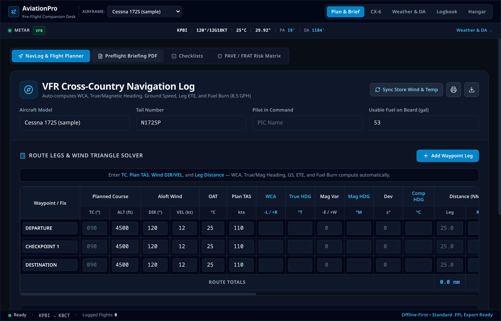
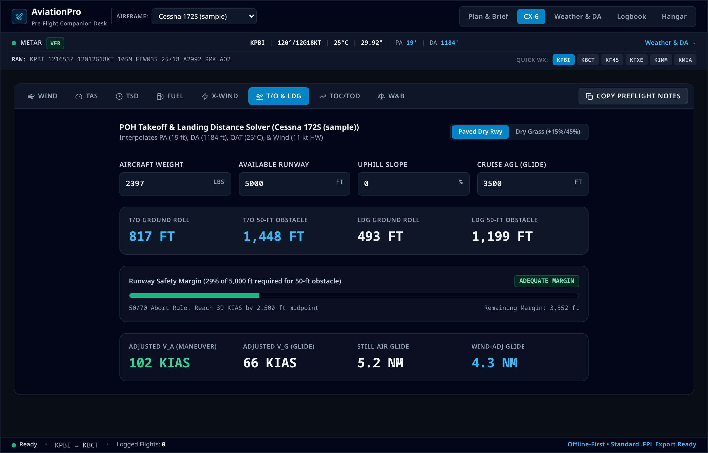
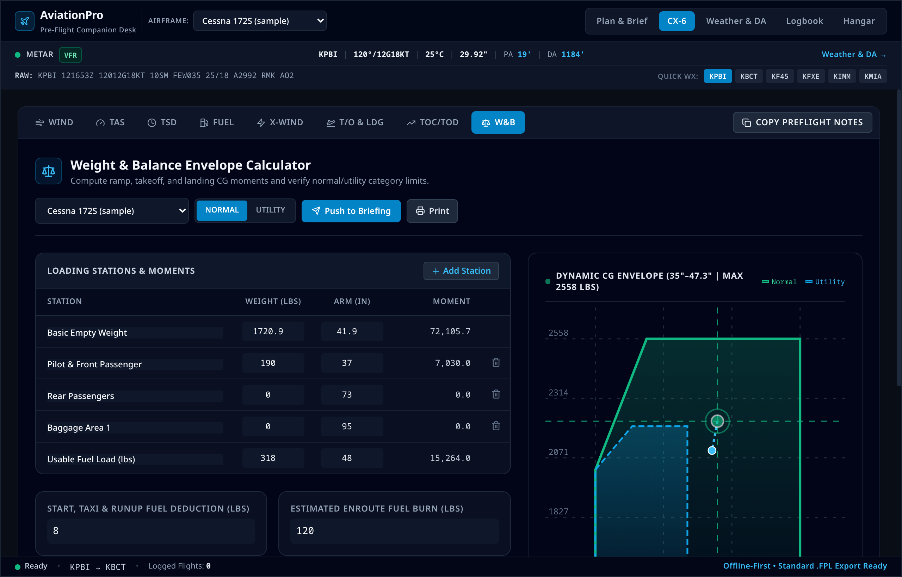
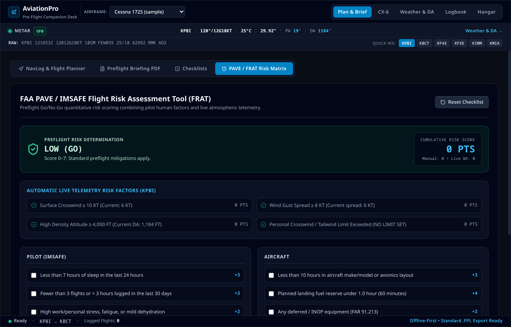
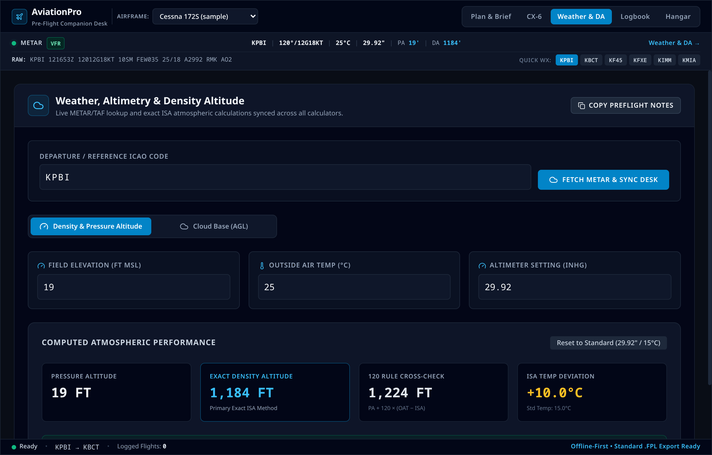
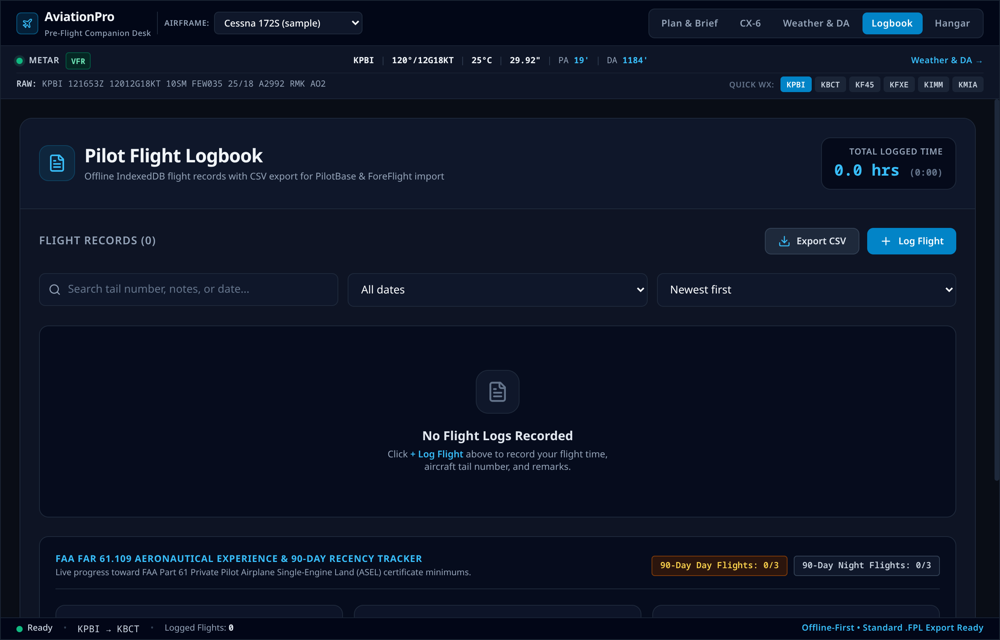
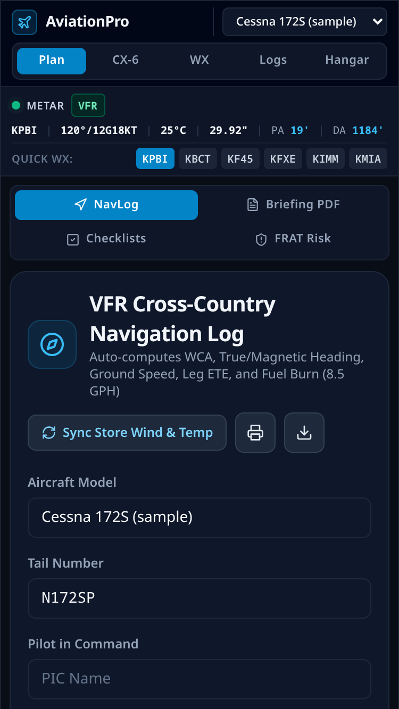
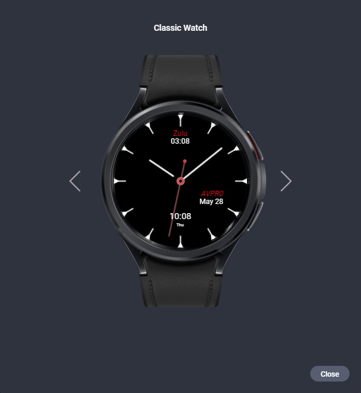
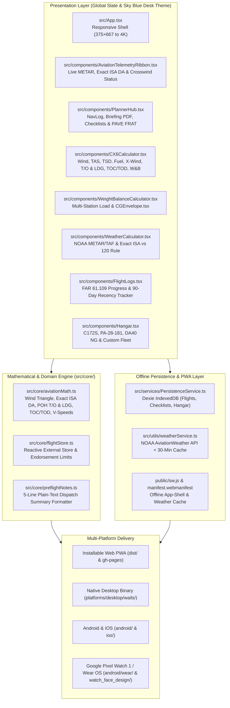

# AviationPro — Preflight Dispatch & E6B Desk Companion

[](https://robfernan.github.io/AviationPro/)
[](LICENSE)
[](tsconfig.json)
[](vite.config.ts)
[](public/manifest.webmanifest)
[](package.json)

**AviationPro** is an enterprise-structured, offline-first preflight planning and E6B/CX-6 flight computer built for student pilots, CFIs, and general aviation dispatch desks. Designed to sit alongside **Flight Schedule Pro**, **PilotBase**, **ForeFlight**, and **E6BX**, it combines exact ISA atmospheric math, POH takeoff & landing distance interpolation, multi-station Weight & Balance CG envelope visualization, FAA PAVE/IMSAFE risk scoring, and Part 61 training progress tracking in a cohesive **Slate & Sky Blue** interface engineered down to the `375×667` iPhone SE viewport benchmark.

- **Live Web & Installable PWA:** [https://robfernan.github.io/AviationPro/](https://robfernan.github.io/AviationPro/)

> [!IMPORTANT]
> **Preflight Planning Notice:** AviationPro is a ground preflight dispatch and training companion. Pilots in Command must always verify performance, weight & balance, and weather data against the official aircraft Pilot's Operating Handbook (POH/AFM) and official aviation weather briefings prior to flight.

---

## Live Application Previews

### Desktop Preflight Dispatch & Navigation Log (`1280×820`)


### POH Takeoff & Landing Solver & Multi-Station Weight & Balance
| POH Takeoff/Landing Distance & V-Speeds (`T/O & LDG`) | Dynamic Multi-Station CG Envelope (`W&B`) |
| :---: | :---: |
|  |  |

### FAA PAVE / IMSAFE Risk Matrix & Live Weather / Density Altitude
| FAA PAVE / IMSAFE Flight Risk Assessment (`FRAT`) | NOAA METAR/TAF & Exact ISA Density Altitude |
| :---: | :---: |
|  |  |

### FAR 61.109 Logbook Tracker, iPhone SE (`375×667`), & Google Pixel Watch 1
| FAR 61.109 & 90-Day Recency Logbook | iPhone SE (`375×667`) Benchmark | Google Pixel Watch 1 / Wear OS |
| :---: | :---: | :---: |
|  |  |  |

---

## System Architecture



---

## Key Preflight & Training Capabilities

| Module | Capabilities |
| :--- | :--- |
| **POH Takeoff & Landing Solver** (`T/O & LDG`) | Bilinear POH performance interpolation across Pressure Altitude, OAT, and Takeoff Weight for C172S, PA-28, and DA40. Automatically applies headwind/tailwind corrections, dry grass runway penalties (`+15%` takeoff / `+45%` landing roll), uphill slope penalties, **50/70 Abort Rule** midpoint callout ($0.70 V_R$), and visual runway margin bar. |
| **Weight-Adjusted $V_A$ & Glide Range** | Computes weight-adjusted maneuvering speed ($V_A = V_{A(\text{max})}\sqrt{W / W_{\text{max}}}$), best glide speed ($V_G$), and still-air vs. wind-adjusted engine-out glide distance in NM. |
| **TOC / TOD Climb & Descent Planner** (`TOC/TOD`) | Calculates Top-of-Climb (`TOC`) distance, time to climb, taxi + climb fuel burn, Top-of-Descent (`TOD`) distance to pattern altitude, and $3^\circ$ glidepath target vertical speed ($\text{FPM}$). |
| **FAA Wind Triangle & Crosswind Computer** | Law-of-sines Wind Correction Angle ($\text{WCA}$), True Heading, and Groundspeed solver plus 3-digit magnetic runway crosswind/headwind/tailwind evaluation against student solo or personal endorsement limits. |
| **Multi-Station Weight & Balance Envelope** | Station-by-station moment calculator plotting **Ramp**, **Takeoff**, and **Landing** CG shift vectors across **Normal** and **Utility** category SVG envelopes. |
| **FAA PAVE / IMSAFE FRAT Risk Matrix** | Quantitative Go/No-Go preflight risk assessment combining human-factor checklists with automatic live weather telemetry triggers (crosswind $\ge 10\text{ kt}$, gust spread $\ge 8\text{ kt}$, density altitude $\ge 4,000\text{ ft}$). |
| **FAR 61.109 & 61.57 Logbook Tracker** | Offline IndexedDB flight logbook with live progress bars for all 6 FAA Part 61 Private Pilot ASEL hour requirements (`40 hr` total, `20 hr` dual, `10 hr` solo, `3 hr` dual XC, `5 hr` solo XC, `3 hr` night), 90-day day/night currency counters, and CSV export. |
| **1-Click Dispatch Notes & `.FPL` Export** | Copies a formatted 5-line plain-text preflight summary (`AviationPro Preflight`, `ACFT`, `WX`, `RWY`, `NAV`) for pasting into **Flight Schedule Pro** or **PilotBase**, alongside printable jsPDF briefings and XML `.fpl` route files. |

---

## Enterprise Repository Structure

```text
AviationPro/
├── assets/
│   └── screenshots/                 # High-DPI application & device screenshots for documentation
│       ├── hero_desktop.png         # 1280×820 VFR Cross-Country NavLog & Flight Planner
│       ├── hero_mobile.png          # 375×667 iPhone SE benchmark mobile view
│       ├── hero_watch_app.png       # Wear OS companion app preview
│       ├── hero_watch_face.png      # Google Pixel Watch 1 Watch Face Studio preview
│       ├── screenshot_flightlog.png # FAR 61.109 & 90-day currency logbook view
│       ├── screenshot_frat.png      # FAA PAVE / IMSAFE FRAT risk assessment matrix
│       ├── screenshot_performance.png # POH Takeoff/Landing distance & V-Speed solver
│       ├── screenshot_wb.png        # Multi-station Weight & Balance CG envelope
│       └── screenshot_weathercalculator.png # Live METAR/TAF & Exact ISA Density Altitude
├── public/
│   ├── manifest.webmanifest         # Installable Web App Manifest (standalone PWA)
│   ├── sw.js                        # Offline-first Service Worker (app shell + weather cache)
│   ├── favicon.svg                  # Slate & Sky Blue scalable vector emblem
│   ├── pwa-192x192.png              # Apple touch & Android home screen icon (192×192)
│   └── pwa-512x512.png              # Splash & maskable PWA icon (512×512)
├── src/
│   ├── core/                        # Pure TypeScript domain math, store & unit tests
│   │   ├── aviationMath.ts          # ISA DA, Wind Triangle, Crosswind, POH T/O & LDG, TOC/TOD
│   │   ├── aviationMath.test.ts     # Mathematical verification suite
│   │   ├── flightStore.ts           # Reactive flight & airframe store
│   │   ├── preflightNotes.ts        # Plain-text dispatch summary builder
│   │   └── preflightNotes.test.ts   # Dispatch note & store integration tests
│   ├── components/                  # React 18 UI modules (Slate & Sky Blue theme)
│   │   ├── AviationTelemetryRibbon.tsx
│   │   ├── Briefing.tsx
│   │   ├── CGEnvelope.tsx
│   │   ├── Checklists.tsx
│   │   ├── CX6Calculator.tsx
│   │   ├── FlightLogs.tsx
│   │   ├── FlightPlanForm.tsx
│   │   ├── FratAssessment.tsx
│   │   ├── Hangar.tsx
│   │   ├── PlannerHub.tsx
│   │   ├── WeatherCalculator.tsx
│   │   └── WeightBalanceCalculator.tsx
│   ├── services/
│   │   └── PersistenceService.ts    # Dexie.js IndexedDB database (Flights, Checklists, Hangar)
│   ├── utils/
│   │   ├── briefingBuilder.ts       # jsPDF flight briefing generator
│   │   ├── fplExport.ts             # XML (.fpl), CSV, and JSON route exporters
│   │   ├── platform.ts              # Runtime target detection (Wails, Capacitor, Web)
│   │   └── weatherService.ts        # NOAA METAR/TAF service with 30-min offline cache
│   ├── data/
│   │   └── sampleAircrafts.json     # Cessna 172S, Piper PA-28, Diamond DA40 NG presets
│   ├── hooks/
│   │   └── useAviation.ts           # Reactive Dexie query hook
│   └── types/
│       └── aviation.ts              # Strict TypeScript domain interfaces
├── scripts/                         # Local verification & multi-platform build scripts
│   ├── verify-all.sh                # TypeScript check, terminology audit, unit tests, build
│   ├── build-web.sh                 # Production web & PWA bundle build
│   ├── build-desktop.sh             # Native Wails desktop binary build
│   ├── build-mobile.sh              # Capacitor Android/iOS & Wear OS asset sync
│   └── deploy-pages.sh              # Direct local deployment of dist/ to GitHub Pages (gh-pages)
├── platforms/
│   ├── desktop/wails/               # Go + Wails native desktop wrapper
│   └── mobile/capacitor/            # Capacitor mobile configuration
├── android/                         # Android & Wear OS companion app (android/wear/)
├── ios/                             # iOS Capacitor target
├── watch_face_design/               # Google Pixel Watch 1 Watch Face Studio project & AAB
└── WATCH_FACE_SPEC.md               # Wear OS watch face specification
```

---

## Local Verification, Build & Deployment Commands

All verification, native builds, and GitHub Pages deployments run locally via `scripts/`:

```bash
# 1. Run the complete verification gate (tsc --noEmit, terminology audit, bun test, vite build)
./scripts/verify-all.sh

# 2. Run unit tests (11 test suites, 75 assertions)
bun test

# 3. Start local development server with NOAA weather proxy
bun run dev

# 4. Build production Web & installable PWA bundle (dist/)
./scripts/build-web.sh

# 5. Deploy production PWA bundle directly to GitHub Pages (gh-pages branch)
./scripts/deploy-pages.sh

# 6. Build native Linux/macOS/Windows desktop binary (platforms/desktop/wails/build/bin/AviationPro)
./scripts/build-desktop.sh

# 7. Sync production bundle to Android & iOS Capacitor targets
./scripts/build-mobile.sh
```

---

## Progressive Web App (PWA) Support

AviationPro is a fully installable **Offline-First Progressive Web App**:
- **Web App Manifest (`public/manifest.webmanifest`):** Supports standalone window mode on iOS, Android, macOS, Windows, and Linux Chrome/Edge/Safari with `192×192`, `512×512`, and vector SVG icons.
- **Offline Service Worker (`public/sw.js`):** Pre-caches the application shell on install, uses **stale-while-revalidate** for static bundles so all calculators, checklists, W&B envelopes, and IndexedDB logbooks work with zero internet connection, and uses **network-first with offline cache fallback** for NOAA METAR/TAF queries.
